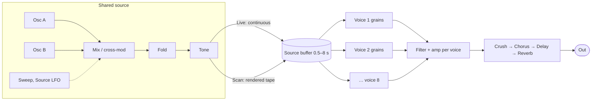

# Drizzle

Drizzle is a granular synthesizer for [Ableton Move](https://www.ableton.com/move/), planned as a
sound-generator module for [Schwung](https://github.com/charlesvestal/schwung). It carries its
own sound source: a small wavetable or virtual-analog synth renders into a shared buffer, and
every note you play becomes a cloud of grains read back from that buffer at the note's pitch.
Sample playback comes later as a second source.

> **Status:** specification. No code yet; see [plan/16-implementation-status.md](plan/16-implementation-status.md).

## The idea

- **Two sources from the sibling synths:** Amino's 8-bit wavetables (Vintage or Clean) and Crest's
  band-limited analog oscillators, with fold, tone, a **Sweep** and a **Source LFO** to keep the
  material moving.
- **Live, Freeze and Scan buffers.** Live records the source continuously; Freeze holds it; Scan
  renders a *tape* of the source sweeping through its timbres, so Position becomes a timbre axis.
- **Grains:** position, spray, size, density, jitter, scan speed, six windows, period lock for
  smooth tones, pitch spray quantised to octaves, fifths or the Move set's scale, reverse grains,
  stereo spread.
- **Rhythm:** a Tempo mode with divisions, swing, probability, repeats and patterns that loop each
  bar, for stutter and glitch.
- **Played from the pads:** pressure moves density, spray and position; four macros per patch;
  a 12-slot matrix for everything else.
- **Effects:** Crush (including 8-bit Bits), Chorus, Delay and Reverb with a Cloud mode and freeze.

## Documents
The spec is in [plan/](plan/README.md): platform and ABI, architecture, sources, buffer, grain
engine, voices, modulation, effects, the parameter reference, Move pages, presets, testing and
the roadmap.

Drizzle is built with the toolchain, codegen and tests of its siblings
[Crest](https://github.com/klaine/crest) and [Amino](https://github.com/klaine/amino).

## Licence
MIT; see [LICENSE](LICENSE).
