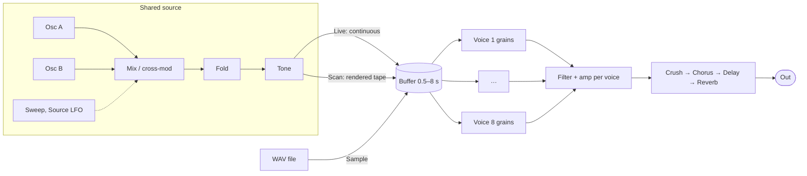

# Drizzle

Drizzle is a granular synthesizer for [Ableton Move](https://www.ableton.com/move/), running as a
sound-generator module in [Schwung](https://github.com/charlesvestal/schwung). It carries its own
sound source: a small wavetable or virtual-analog synth renders into a buffer, and every note you play
becomes a cloud of grains read back from that buffer at the note's pitch. It can also grain your own
samples.

- **Play it in your browser:** <https://klaine.github.io/drizzle/> (the same DSP compiled to
  WebAssembly, with Web MIDI)
- **Download for Move:** the latest release's `drizzle-module.tar.gz`
- **Every page and knob:** [plan/10-parameter-reference.md](plan/10-parameter-reference.md)
- **The spec and what is built:** [plan/README.md](plan/README.md) and
  [plan/16-implementation-status.md](plan/16-implementation-status.md)

> **Status:** 0.1.0. Everything in the spec is built and tested on the build machine and in the
> browser, but Drizzle has not yet run on a Move: the checks in
> [plan/16](plan/16-implementation-status.md) come first.

## Installing on Move

Drizzle needs a Move with [Schwung](https://github.com/charlesvestal/schwung) installed.

1. Download `drizzle-module.tar.gz` from the latest release.
2. Install it by uploading it in Schwung Manager, or by hand: extract the archive so that it lands at
   `/data/UserData/schwung/modules/sound_generators/drizzle/` on the Move.
3. Rescan modules in Schwung Manager, or restart Schwung.

Drizzle then appears under Sound Generators as **DRZL**. For Sample mode, copy `.wav` files to
`/data/UserData/UserLibrary/Drizzle` (subfolders are fine).

Developers with SSH access (add a key at `http://move.local/development/ssh`) can install a local
build with `scripts/deploy.sh [host]`; `scripts/logs.sh` follows Schwung's debug log.

## How it works



### Source

- **Wavetable:** two oscillators over 74 8-bit tables of 64 waves (Amino's tables). Vintage steps
  between waves, 8-bit style; Clean blends them. Osc B cross-modulates A by ring, PM or sync.
- **Analog:** two band-limited oscillators (sine, triangle, saw, pulse with Shape), a stack of detuned
  copies, FM, sync and noise (Crest's oscillators).
- **Sample:** any WAV file, mixed to mono and resampled on a loader thread; a start and end region.
  Ten factory samples come with it: string sections, tremolo, pizzicato, harp and an "orchestra
  tour" recorded by Versilian Studios (VSCO 2 CE, CC0), and a synthesised choir.
- **Fold** and **Tone** shape either synth, and two motion generators move it: the **Sweep** (a curve
  across the tape, or over time) and the **Source LFO**, each to Timbre, Fold, Pitch and Tone.

### Buffer

- **Scan** renders a *tape*: the source sweeping through its timbres, 0.5 to 8 s long, at 8× realtime.
  Position then picks a timbre; a Sweep on Pitch makes a glissando tape that Position plays as notes.
  A tape depends only on the patch, so it is the same every time the patch loads.
- **Live** records the source all the time, and **Track Notes** makes it play the newest key.
- **Freeze** holds either one (CC 69 toggles it); a frozen Live buffer loops without a seam.

### Grains

Position, Spray, Size, Density, Jitter and Scan Speed; six windows (Hann, Gauss, Tukey, Perc, Swell,
Rect); grain pitch and pitch spray quantised to octaves, fifths or the Move set's scale; reverse
probability; stereo spread; level spray; **Period Lock**, which lines grains up so a cloud of one
note becomes a clean tone. Up to 128 grains over 8 voices; tails thin out as notes release.

### Rhythm

**Tempo** mode plays one grain per grid step (1/64 to a bar) on Move's tempo, with swing,
probability, repeats, and random patterns that repeat per note or loop every bar.

### Voices and modulation

- 8 voices: Poly, Mono or Legato, glide, Flavour (small random offsets per note).
- A filter per voice (LP24, LP12, BP12, HP12, with drive), Amp and Mod envelopes.
- LFO 1 per voice and LFO 2 for all voices (locked to the bar if you like), with direct depths.
- **Pressure** from the pads moves density and spray out of the box, and more from its own page.
- A 12-slot **matrix** of 24 sources (`source × via`) to 32 destinations, and four macros.

### Effects

Crush (Soft, Hard, Fold, and Bits for 8-bit grit), Chorus, Delay (tempo sync, ping-pong) and Reverb
(Room, Hall, Plate, and Cloud with decays up to 60 s), with Reverb Freeze.

### Patches

78 factory patches, levelled against each other: Init (4), Pad (15), Texture (12), Drone (8),
Keys & Bells (8), Motion (6), Rhythm & Glitch (12) and Orchestra & Choir (13). Every patch gives
Macros 1–4 a job (motion, texture, space and a trick of its own) and the mod wheel one more.

## On the Move

The first page draws the buffer, where new grains start and the grains playing now. The Main page
has Position, Spray, Size, Density, Pitch Spray, Scan, Space (reverb) and Freeze. Jog turns pages;
Shift+jog-click opens the section picker: Source, Wavetable, Analog, Sample, Sweep, Source LFO,
Grains, Grain Pitch, Rhythm, Filter, Envelopes, Voice, LFOs, Pressure, Mod Matrix, Perform and the
effects. Turning a knob shows a card with its value in real units. The help pages explain each
section, and the Remote UI (Schwung's browser view of the slot) edits everything with a preset browser.

## Building

```sh
scripts/build.sh            # tests, the aarch64 dsp.so, drizzle-module.tar.gz and build/drizzle.html
scripts/build.sh --gen      # after editing tools/gen/params.py or presets/factory/
scripts/build_web.sh        # the browser synth: build/site and build/drizzle.html
scripts/deploy.sh [host]    # install on a Move over SSH
```

It needs [zig](https://ziglang.org) (or `pip install ziglang`), Python 3 and, for the UI tests,
Node.js. `tools/level/level.py` levels the factory bank; `CONTRIBUTING.md` has the rules.

Drizzle borrows its toolchain, oscillators, filter, effects and web UI from its siblings
[Crest](https://github.com/klaine/crest) and [Amino](https://github.com/klaine/amino), and its
wavetables from Amino.

## Licence

MIT; see [LICENSE](LICENSE) and [THIRD_PARTY_NOTICES.md](THIRD_PARTY_NOTICES.md).
